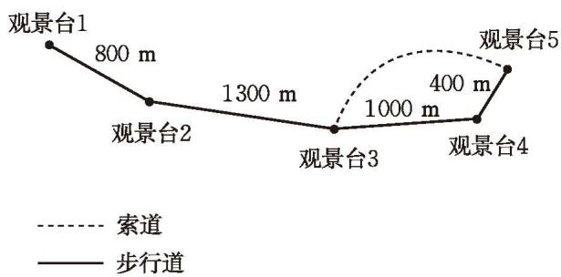
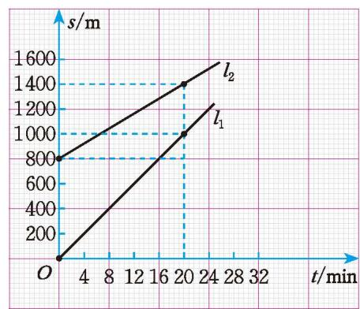

例3 图4-11是某景区游览路线示意图。甲在观景台1联系乙，发现乙在观景台2，于是沿着游览路线追赶乙。图4-12中 $l_{1}, l_{2}$ 分别表示两人到观景台1的路程与追赶时间之间的关系。

图4-11

图4-12

假设甲、乙两人保持现有的速度，根据图象回答下列问题：

(1) 哪条线表示甲到观景台 1 的路程与追赶时间之间的关系?

(2) 甲和乙哪个人的速度快?

(3) $30 \mathrm{~min}$ 内甲能否追上乙?

(4) 到达观景台 3 后道路分岔, 甲能否在到达观景台 3 前追上乙?

(5) 设 $l_{1}$ 与 $l_{2}$ 对应的两个一次函数分别为 $s = k_{1} t + b_{1}$ 与 $s = k_{2} t + b_{2}, k_{1}, k_{2}$ 的实际意义各是什么？甲、乙两人的速度各是多少？

