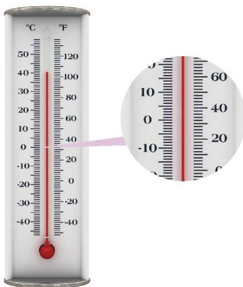

9. (1) 全世界大部分国家都采用摄氏温标表示温度, 但也有部分国家采用华氏温标。因此, 一般温度计上都同时标注了摄氏温度和华氏温度 (如图)。观察温度计上对应的摄氏温度和华氏温度数值, 尝试写出华氏温度 $y$ (单位: ${}^{ \circ}\mathrm{F}$ ) 与摄氏温度 $x$ (单位: ${}^{ \circ}\mathrm{C}$ ) 之间的关系式, 并说明你的研究过程。

(2) 现实生活中的一些量有不同的计量单位, 如对于长度, 既有法定计量单位 $\mathrm{m}$ , $\mathrm{cm}$ 等, 又有传统的尺、寸等。找出几种测

[第9(1)题]

量工具，观察并设法求出同一个量不同计量单位之间的关系。
