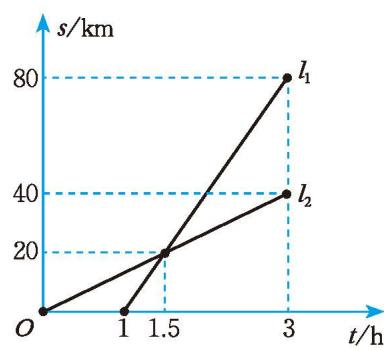

10. A, B 两地相距 $80 \mathrm{~km}$ , 甲、乙两人沿同一条路从 A 地到 B 地。 $l_{1}, l_{2}$ 分别表示甲、乙两人离开 A 地的距离与乙出发后的时间之间的关系。根据图象填空:

(1) 乙比甲先出发 \_\_\_\_ h;

(2) 乙出发 \_\_\_\_ h 时, 两人相遇, 这时他们离开 A 地 \_\_\_\_ km;

(第10题)

(3) 甲的速度是 \_\_\_\_ km/h，乙的速度是 \_\_\_\_ km/h。
