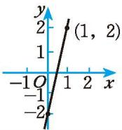

4. 下面分别给出了三个一次函数的一种表示方式，试写出它们的另外两种表示方式。

<table><tr><td colspan="8">表</td><td>图</td><td>式</td></tr><tr><td>x</td><td>...</td><td>-2</td><td>0</td><td>1</td><td>2</td><td>3</td><td>...</td><td rowspan="3"></td><td rowspan="3"></td></tr><tr><td>y</td><td>...</td><td>10</td><td>4</td><td>1</td><td>-2</td><td>-5</td><td>...</td></tr><tr><td colspan="8"></td></tr><tr><td>x</td><td>...</td><td>-2</td><td>0</td><td>1</td><td>2</td><td>3</td><td>...</td><td rowspan="3"></td><td rowspan="3"></td></tr><tr><td>y</td><td>...</td><td></td><td></td><td></td><td></td><td></td><td>...</td></tr><tr><td colspan="8"></td></tr><tr><td>x</td><td>...</td><td>-2</td><td>0</td><td>1</td><td>2</td><td>3</td><td>...</td><td rowspan="2"></td><td rowspan="2"> $y=\frac{1}{2}x-3$ </td></tr><tr><td>y</td><td>...</td><td></td><td></td><td></td><td></td><td></td><td>...</td></tr></table>
