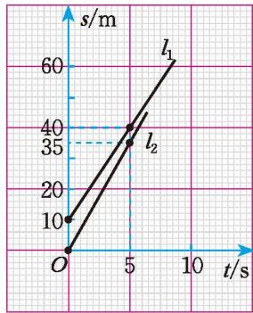

13. 小明和小亮进行百米赛跑，小明比小亮跑得快。如果两人同时起跑，小明肯定赢。现在小明让小亮先跑若干米。图中 $l_{1}, l_{2}$ 分别表示两人的路程与小明追赶时间之间的关系。

(1) 哪条线表示小明的路程与追赶时间之间的关系?

(2) 小明让小亮先跑了多少米?

(3) 谁将赢得这场比赛?

(4) $l_{1}$ 对应的一次函数表达式中, 一次项系数是多少? 它的实际意义是什么?

(第13题)
