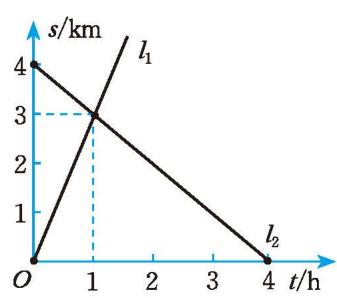

1. 右图中 $l_{1}$ 与 $l_{2}$ 两条线的交点坐标可以看作哪个方程组的解?

(第1题)

## 相关知识点

- [二元一次方程组与一次函数图象交点关系探索（范围关联）](../%E7%9F%A5%E8%AF%86%E7%82%B9/%E4%BA%8C%E5%85%83%E4%B8%80%E6%AC%A1%E6%96%B9%E7%A8%8B%E7%BB%84%E4%B8%8E%E4%B8%80%E6%AC%A1%E5%87%BD%E6%95%B0%E5%9B%BE%E8%B1%A1%E4%BA%A4%E7%82%B9%E5%85%B3%E7%B3%BB%E6%8E%A2%E7%B4%A2.md)
- [待定系数法的概念与步骤（范围关联）](../%E7%9F%A5%E8%AF%86%E7%82%B9/%E5%BE%85%E5%AE%9A%E7%B3%BB%E6%95%B0%E6%B3%95%E7%9A%84%E6%A6%82%E5%BF%B5%E4%B8%8E%E6%AD%A5%E9%AA%A4.md)

> 来源：北师大版初中数学·八年级上册
