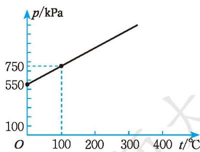

6. 对于密闭容器内的气体, 其压强 $p$ (单位: $\mathrm{kPa}$ ) 是温度 $t$ (单位: ${}^{ \circ }\mathrm{C}$ ) 的一次函数。现测得某密闭容器内气体的压强 $p$ 与温度 $t$ 之间的

(第6题)

关系如图所示。

(1) 求 $60^{\circ} \mathrm{C}$ 时该容器内气体的压强;

(2) 通常情况下, 当压强不超过 $1200 \mathrm{kPa}$ 时, 该容器是安全的 (否则会有破裂甚至爆炸的风险), 求该容器的安全温度 (超过该温度就有安全风险)。
