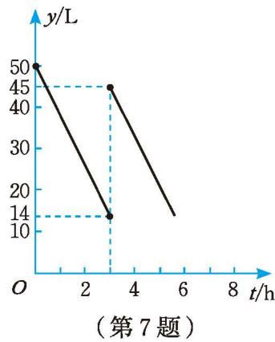

7. 汽车出发前油箱内有油 50 L，行驶一段时间在加油站加油若干升。汽车出发后，油箱中的剩余油量 y（单位：L）与行驶时间 t（单位：h）之间的关系如图所示。

(1) 汽车行驶了 \_\_\_\_ h 在加油站加油，加油 \_\_\_\_ L。

(2) 求加油前油箱中剩余油量 $y$ 与行驶时间 $t$ 之间的关系式。

(3) 如果加油前、加油后汽车都以 $70 \mathrm{~km} / \mathrm{h}$ 的速

度匀速行驶，加油站距离目的地 210 km，那么要到达目的地，油箱中的油是否够用？请说明理由。
