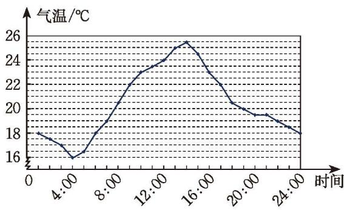
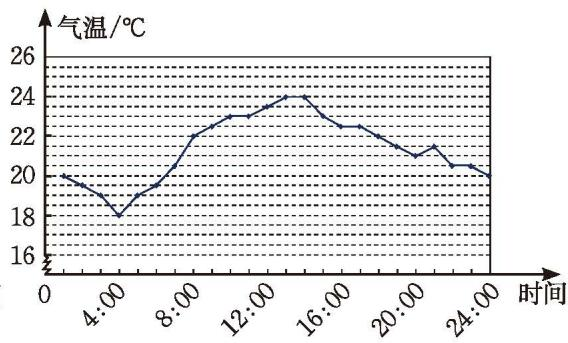

<table><tr><td>甲、乙两支仪仗队队员的身高(单位:cm)如下。</td></tr><tr><td>甲队:178 177 179 179 178 178 177 178 177 179</td></tr><tr><td>乙队:178 177 179 176 178 180 180 178 176 178</td></tr><tr><td>哪支仪仗队队员的身高更为整齐?你是怎么判断的?</td></tr></table>

某日，A，B两地的气温如图6-5所示。

A地

图6-5

B地

(1) 不进行计算, 说说 A, B 两地这一天气温的特点。

(2) 分别计算这一天 A, B 两地气温的平均数和方差, 所得结果与你刚才的看法一致吗?
