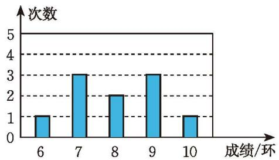
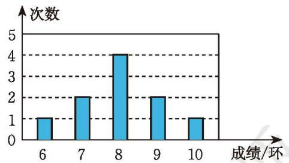
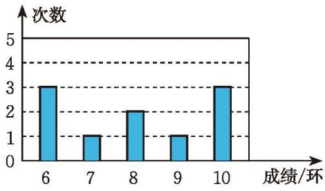

17. (1) 下面两幅图分别表示甲、乙两名队员的射击成绩, 你能从中 “读” 出他们射击成绩的平均数吗? 你是怎么做的?

[第17（1）题]

(2) 根据 (1) 中的统计图, 你能通过估计比较甲、乙两名队员射击成绩的方差的大小吗? 你是怎么估计的?

(3) 根据 (1) 中的统计图, 分别计算甲、乙两名队员射击成绩的方差, 你在 (2) 中的估计是否正确?

(4) 如果丙队员的射击成绩如下图所示, 那么三人射击成绩的方差谁的最大, 谁的最小? 你是怎样判断的?

[第17（4）题]
