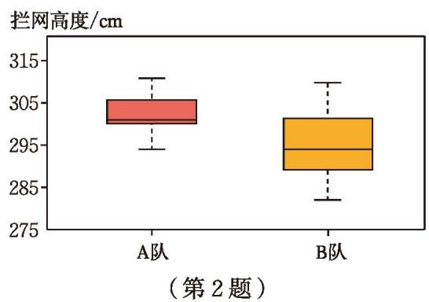

2. 在某场女排决赛中，A 队战胜 B 队获得冠军。下图反映了两队队员拦网高度情况，请比较两队拦网高度情况。

## 相关知识点

- [箱线图的概念与画法形式（范围关联）](../%E7%9F%A5%E8%AF%86%E7%82%B9/%E7%AE%B1%E7%BA%BF%E5%9B%BE%E7%9A%84%E6%A6%82%E5%BF%B5%E4%B8%8E%E7%94%BB%E6%B3%95%E5%BD%A2%E5%BC%8F.md)
- [利用计算机软件求统计量（平均数、中位数、方差、四分位数）与绘制箱线图（范围关联）](../%E7%9F%A5%E8%AF%86%E7%82%B9/%E5%88%A9%E7%94%A8%E8%AE%A1%E7%AE%97%E6%9C%BA%E8%BD%AF%E4%BB%B6%E6%B1%82%E7%BB%9F%E8%AE%A1%E9%87%8F%EF%BC%88%E5%B9%B3%E5%9D%87%E6%95%B0%E3%80%81%E4%B8%AD%E4%BD%8D%E6%95%B0%E3%80%81%E6%96%B9%E5%B7%AE%E3%80%81%E5%9B%9B%E5%88%86%E4%BD%8D%E6%95%B0%EF%BC%89%E4%B8%8E%E7%BB%98%E5%88%B6%E7%AE%B1%E7%BA%BF%E5%9B%BE.md)
- [箱线图的统计功能与多组数据比较优势（范围关联）](../%E7%9F%A5%E8%AF%86%E7%82%B9/%E7%AE%B1%E7%BA%BF%E5%9B%BE%E7%9A%84%E7%BB%9F%E8%AE%A1%E5%8A%9F%E8%83%BD%E4%B8%8E%E5%A4%9A%E7%BB%84%E6%95%B0%E6%8D%AE%E6%AF%94%E8%BE%83%E4%BC%98%E5%8A%BF.md)

> 来源：北师大版初中数学·八年级上册
