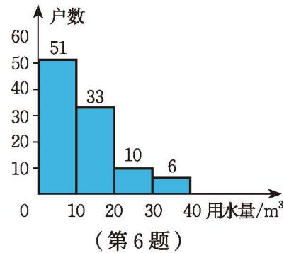

6. 某小区有 500 户家庭，从中随机抽取了 100 户，调查了他们 5 月的用水量

(1) 试估计该小区用水量不高于 $20 \mathrm{~m}^{3}$ 的户数占小区总户数的百分比;

(2) 把图中每组用水量的值用该组的中间值（如 0\~10 的中间值为 5）来代替，估计该小区 5 月的用水量。

## 相关知识点

暂无已审核的相关知识点。

> 来源：北师大版初中数学·八年级上册
