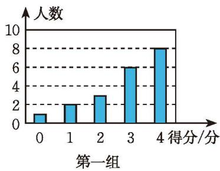
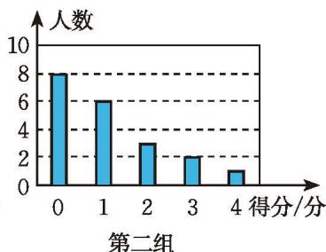
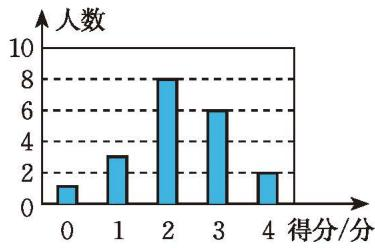

18. 三个小组（每组20人）答一道满分为4分的题目，得分情况如下：

(第18题)

第三组

(1) 请分别计算三个小组该题得分的平均数和方差。

(2) 观察这三个小组的得分统计图, 小明发现, “柱子的高度”都是 $1, 2, 3, 6, 8$ , 但 “柱子” 的排列顺序不同, 导致了平均数和方差发生了变化。若将这些 “柱子” 重新排列, 则如何排列能使平均数最大? 如何排列能使方差最小?

(3) 如果用三个箱线图分别表示这三个小组的得分, 那么这三个箱线图有什么差异?

## 相关知识点

暂无已审核的相关知识点。

> 来源：北师大版初中数学·八年级上册
