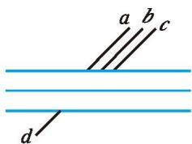

1. 图（1）中有三条线段 $a, b, c$ ，哪一条和线段 $d$ 在同一条直线上？请你先观察，再用直尺验证。图（2）中两条线段 $a$ 与 $b$ 的长度相等吗？

(1)

(2)

(第1题)

## 相关知识点

- [数学证明的必要性（观察、实验、归纳的局限性与推理论证）（范围关联）](../%E7%9F%A5%E8%AF%86%E7%82%B9/%E6%95%B0%E5%AD%A6%E8%AF%81%E6%98%8E%E7%9A%84%E5%BF%85%E8%A6%81%E6%80%A7%EF%BC%88%E8%A7%82%E5%AF%9F%E3%80%81%E5%AE%9E%E9%AA%8C%E3%80%81%E5%BD%92%E7%BA%B3%E7%9A%84%E5%B1%80%E9%99%90%E6%80%A7%E4%B8%8E%E6%8E%A8%E7%90%86%E8%AE%BA%E8%AF%81%EF%BC%89.md)

> 来源：北师大版初中数学·八年级上册
