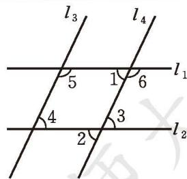

1. 下列推理是否正确？为什么？

(1) 如图，

$$
\begin{array}{l l} \because & \angle 1 = \angle 2, \\ \therefore & l _ {1} / / l _ {2}; \end{array}
$$

(第1题)

(2) 如图,
∵ $\angle4+\angle5=180^{\circ}$ ,
∴ $l_{3} \parallel l_{4}$ ;

(3) 如图, $\because \angle2=\angle4,$ $\therefore l_{3} \parallel l_{4};$

(4) 如图, $\because \angle3+\angle6=180^{\circ},$ $\therefore l_{1} \parallel l_{2}$
