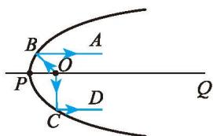

8. 太阳灶、卫星信号接收器、探照灯以及其他很多灯具都与抛物线有关。如图, 从点 $O$ 照射到抛物线上的光线 ${OB}$ , ${OC}$ 等反射以后沿着与 ${POQ}$ 平行的方向射出。如果 $\angle {BOP} = {45}^{ \circ  },\angle {QOC} = {88}^{ \circ  }$ ,那么 $\angle {ABO}$ 和 $\angle {DCO}$ 各是多少度？

(第8题)
