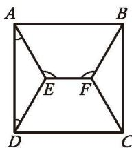

2. 将正方形的四个顶点用线段连接, 什么样的连法线段之和最短? 研究发现, 并非对角线最短, 而是如图所示的连法线段之和最短 (即用线段 $AE$ , $DE$ , $EF$ , $BF$ , $CF$ 把四个顶点连接起来)。已知图中 $\angle DAE = \angle ADE = 30^{\circ}$ , $\angle AEF = \angle BFE = 120^{\circ}$ , 请证明 $AB \parallel EF$ 。

(第2题)

## 相关知识点

暂无已审核的相关知识点。

> 来源：北师大版初中数学·八年级上册
