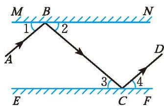

10. 如图, $MN$ , $EF$ 分别表示两面互相平行的镜面, 一束光线 $AB$ 照射到镜面 $MN$ 上, 反射光线为 $BC$ , 此时, $\angle 1 = \angle 2$ ; 光线 $BC$ 经镜面 $EF$ 反射后的反射光线为 $CD$ , 此时 $\angle 3 = \angle 4$ 。试判断 $AB$ 与 $CD$ 的位置关系, 你是如何思考的?

(第10题)

## 相关知识点

暂无已审核的相关知识点。

> 来源：北师大版初中数学·八年级上册
