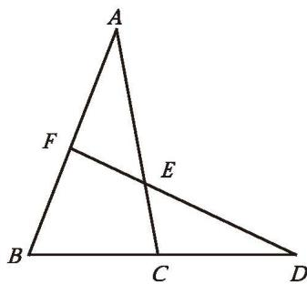

3. 如图, $\angle ACD$ 是 $\triangle ABC$ 的一个外角, 过点 $D$ 的直线分别交 $AC$ 和 $AB$ 于点 $E$ , $F$ 。下列哪个结论一定不正确?

(1) $\angle B > \angle ACD$ ;

(2) $\angle B + \angle ACB = 180^{\circ} - \angle A;$

(3) $\angle B + \angle ACB < 180^{\circ}$ ;

(4) $\angle FEC > \angle B$ 。

(第3题)
