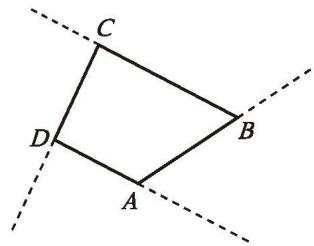
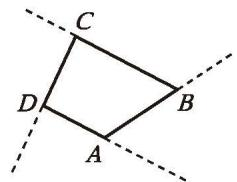
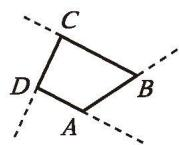
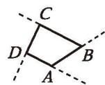

14. 下图中的四边形是同一个四边形不断缩小（保持形状不变）的结果。

(第14题)

(1) 在图中标出各个四边形的外角。

(2) 在缩小的过程中, 四边形对应的各个外角的大小是否发生了变化?

(3) 如果保持四边形的形状不变, 将四边形不断缩小下去, 请你想象一下最终的形状, 并借助这一变化过程说明四边形的外角和。

(4) 请用类似 (3) 的方法说明五边形、六边形……一般多边形的外角和。

## 相关知识点

暂无已审核的相关知识点。

> 来源：北师大版初中数学·八年级下册
