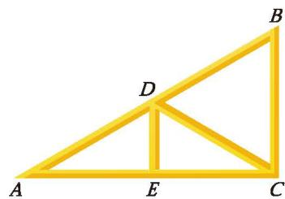

9. 某屋架的一部分如图所示, 其中 $BC \perp AC$ , $\angle A = 30^{\circ}$ , $AB = 7.4 \mathrm{~m}$ , 点 $D$ 是 $AB$ 的中点, 且 $DE \perp AC$ , 垂足为 $E$ , 求 $BC$ , $DE$ 的长。

(第9题)

## 相关知识点

暂无已审核的相关知识点。

> 来源：北师大版初中数学·八年级下册
