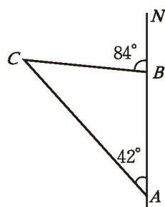

12. 如图, 一艘轮船从 $A$ 处出发, 以 $18 \mathrm{~kn}^{\textcircled{①}}$ 的速度向正北航行, 经过 $10 \mathrm{~h}$ 到达 $B$ 处。分别从 $A$ , $B$ 处望灯塔 $C$ , 测得 $\angle NAC = 42^{\circ}, \angle NBC = 84^{\circ}$ 。求从 $B$ 处到灯塔 $C$ 的距离。

(第12题)
