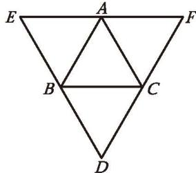

13. (1) 如图, $\triangle ABC$ 是等边三角形, 过它的三个顶点分别作对边的平行线, 得到一个新的 $\triangle DEF$ , $\triangle DEF$ 是等边三角形吗? 你还能找到哪些其他的等边三角形? 点 $A, B, C$ 分别是 $EF, ED, FD$ 的中点吗? 请证明你的结论。

(第13题)

(2) 如果 $\triangle DEF$ 是等边三角形，点 A, B, C 分别

是 $EF, ED, FD$ 的中点, 那么 $\triangle ABC$ 是等边三角形吗? 请证明你的结论。
