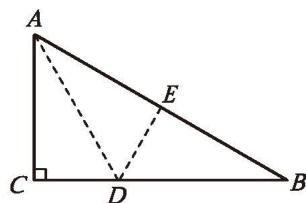

10. 在如图所示的三角形纸片 $ABC$ 中, $\angle C = 90^{\circ}$ , $\angle B = 30^{\circ}$ 。按如下步骤,可以把这张直角三角形纸片分成三张全等的小直角三角形纸片 (图中虚线表示折痕): ① 折叠三角形纸片 $ABC$ , 使点 $B$ 与点 $A$ 重合, 折痕交 $BC$ 于点 $D$ , 交 $AB$ 于点 $E$ ; ② 将折叠后的纸片再沿 $AD$ 折叠。

(1) 由步骤①可以得到哪些等量关系?

(2) 请证明 $\triangle ACD \cong \triangle AED$ 。

(3) 按照这种方法, 能否将任意一个直角三角形分成三个全等的小三角形?

(第10题)
