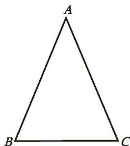

2. 如图,在 $\bigtriangleup  {ABC}$ 中, ${AB} = {AC},{AB} > {BC}$ ,完成下列尺规作图：

(1) 作 $AC$ 边上的高 $BD$ ;

(2)作 $\triangle ACE$ , 使 $\triangle ACE \cong \triangle ABD$ , 且点 $E$ 在 $AB$ 边上。

(第2题)

## 相关知识点

暂无已审核的相关知识点。

> 来源：北师大版初中数学·八年级下册
