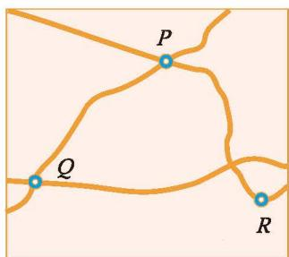
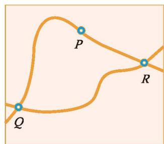

7. 某市打算修建一个大型体育中心。在选址过程中，有人建议该体育中心所在位置到该市的三个城镇中心（图中以 $P, Q, R$ 表示）的距离应相等。

(1) 根据上述建议, 试在图 (1) 中画出体育中心 $G$ 的位置。

(2) 如果这三个城镇中心的位置如图 (2) 所示, $\angle RPQ$ 是一个钝角, 那么根据上述建议, 体育中心 $G$ 应建在什么位置?

(1)

(第7题)
(2)

(3) 你对上述建议有何评论? 你对选址有什么建议?
