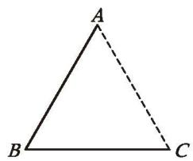
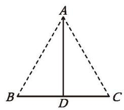
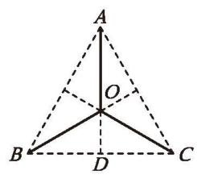

8. 如图, 某市三个城镇中心 $A, B, C$ 恰好分别位于一个等边三角形的三个顶点处, 在三个城镇中心之间铺设通信光缆, 以城镇中心 $A$ 为出发点设计了三种连接方案:

(1) $AB + BC$ ;

(2) $AD + BC$ ( $D$ 为 $BC$ 的中点);

(3) ${OA} + {OB} + {OC}$ ( $O$ 为 $\bigtriangleup  {ABC}$ 三边的垂直平分线的交点)。

要使铺设的光缆长度最短，应选哪种方案？

(1)

(2)

(第8题)

(3)
