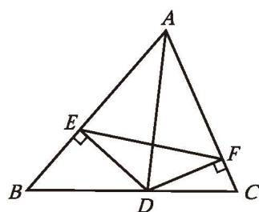

6. 如图, 在 $\triangle ABC$ 中, 点 $D$ 在边 $BC$ 上, $DE \perp AB$ , $DF \perp AC$ , 垂足分别为 $E, F$ , 连接 $AD, EF$ 。当 $AD$ 与 $EF$ 满足什么条件时, $AD$ 是 $\triangle ABC$ 的角平分线? 为什么?

(第6题)

## 相关知识点

暂无已审核的相关知识点。

> 来源：北师大版初中数学·八年级下册
