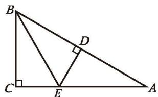

7. 如图, 在 $\triangle ABC$ 中, $\angle C = 90^{\circ}$ , $\angle A = 30^{\circ}$ , 作 $AB$ 的垂直平分线, 交 $AB$ 于点 $D$ , 交 $AC$ 于点 $E$ , 连接 $BE$ , 则 $BE$ 平分 $\angle ABC$ 。请证明这一结论。你有几种证明方法?

(第7题)

## 相关知识点

暂无已审核的相关知识点。

> 来源：北师大版初中数学·八年级下册
