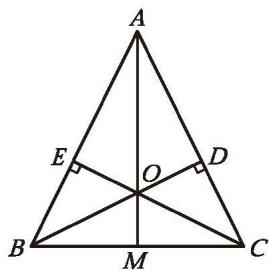

11. 如图, $\triangle ABC$ 的高 $BD$ 与 $CE$ 相交于点 $O$ , $OD = OE$ , $AO$ 的延长线交 $BC$ 于点 $M_0$ 。

(1) 从图中找出几对全等直角三角形, 并给出证明。

(2)求证： $\triangle ABC$ 是等腰三角形。

(第11题)

## 相关知识点

暂无已审核的相关知识点。

> 来源：北师大版初中数学·八年级下册
