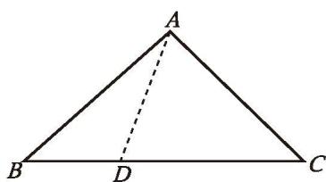

12. 已知：如图，在 $\triangle ABC$ 中， $BC > AC$ 。

求证： $\angle {BAC} > \angle B$ 。

> [!success]- 答案与解析
>
> > [!success] **【答案】** 详见解析
>
> > [!note]- **【解析】**
> > 证明：由 $BC > AC$ ，可在 $BC$ 边上截取 $CD = AC$ ，连接 $AD$ 。……
> > 请你完成证明过程。
> >
> > 
> >
> > (第12题)
