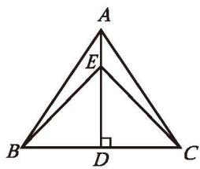
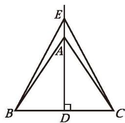

13. 在 $\triangle ABC$ 中， $AB=AC$ ， $AD\perp BC$ ，垂足为 $D$ 。

(1)如图(1),点 $E$ 在线段 $A D$ 上,连接 $B E$ , $C E$ 。请找出图中所有相等

的角，并说明理由。

(2)如图(2), 点 $E$ 在线段 $DA$ 的延长线上, 连接 $BE$ , $CE$ 。请找出图中所有相等的线段、相等的角, 并说明理由。

(3) 你还可以提出哪些问题?

(1)

(第13题)
(2)
