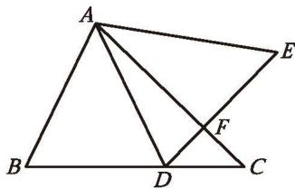

18. 如图, 在 $\triangle ABC$ 中, $\angle B = 64^{\circ}$ , $\angle BAC = 72^{\circ}$ , $D$ 为边 $BC$ 上的一点, $DE$ 交 $AC$ 于点 $F$ , 且 $AB = AD = DE$ , 连接 $AE$ , $\angle E = 55^{\circ}$ 。请判断 $\triangle AFD$ 的形状, 并说明理由。

(第18题)

## 相关知识点

暂无已审核的相关知识点。

> 来源：北师大版初中数学·八年级下册
