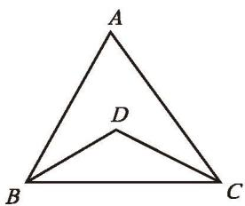
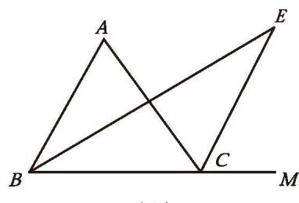
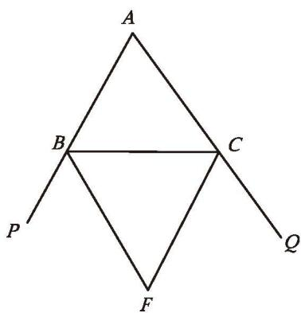

19. (1) 如图 (1), 在 $\triangle ABC$ 中, $BD$ 平分 $\angle ABC$ , $CD$ 平分 $\angle ACB$ , 试确定 $\angle A$ 和 $\angle D$ 的数量关系;

(2) 如图 (2), 在 $\triangle ABC$ 中, $BE$ 平分 $\angle ABC$ , $CE$ 平分外角 $\angle ACM$ , 试确定 $\angle A$ 和 $\angle E$ 的数量关系;

(3) 如图 (3), 在 $\triangle ABC$ 中, $BF$ 平分外角 $\angle CBP$ , $CF$ 平分外角 $\angle BCQ$ , 试确定 $\angle A$ 和 $\angle F$ 的数量关系。

(1)

(第19题)

(3)
