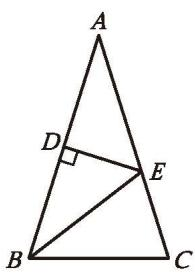

21. 如图, 在 $\triangle ABC$ 中, $AB = AC$ , $AB$ 的垂直平分线交 $AB$ 于点 $D$ , 交 $AC$ 于点 $E$ 。已知 $\triangle BCE$ 的周长为 8 , $AC - BC = 2$ , 求 $AB$ 和 $BC$ 的长。

(第21题)

## 相关知识点

暂无已审核的相关知识点。

> 来源：北师大版初中数学·八年级下册
