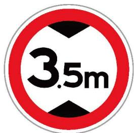
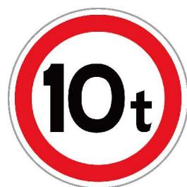

11. 在通过桥洞时, 我们往往会看到如图

(1) 所示的标志, 它表示禁止车货总体外廓高度超过标志所示数值的车辆通行。在通过桥面时, 我们往往会看到如图

(2) 所示的标志, 它表示禁止装载总质量超过标志所示数值的车辆通行。请用不等式分别表示可通过该桥洞车辆的车货总体外廓高度 $x$ (单位: $\mathrm{m}$ ) 的范围, 以及可通过该桥面车辆的装载总质量 $y$ (单位: t) 的范围。

(1)

(2)

(第11题)
