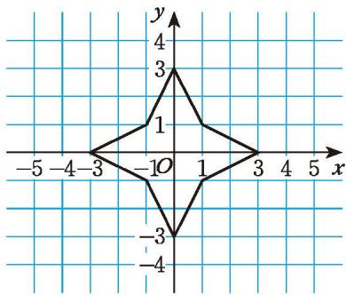

4. 如图所示的图形是将坐标为 $(0,3), (1,1), (3,0), (1,-1), (0,-3), (-1,-1), (-3,0), (-1,1), (0,3)$ 的点用线段依次连接而成的。将上述各“顶点”的纵坐标保持不变，横坐标分别加 3，再将得到的点用线段依次连接起来，这样得到的图形与原图形相比有什么变化？如果原图形各“顶点”的横坐标保持不变，纵坐标分别加 3 呢？

(第4题)

## 相关知识点

暂无已审核的相关知识点。

> 来源：北师大版初中数学·八年级下册
