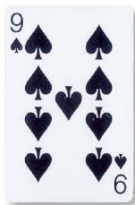
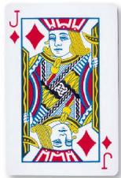
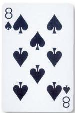
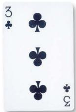

2. 下面扑克牌中, 哪些牌的牌面是中心对称图形?

(第2题)

## 相关知识点

- [旋转对称图形的概念（范围关联）](../%E7%9F%A5%E8%AF%86%E7%82%B9/%E6%97%8B%E8%BD%AC%E5%AF%B9%E7%A7%B0%E5%9B%BE%E5%BD%A2%E7%9A%84%E6%A6%82%E5%BF%B5.md)
- [成中心对称的基本性质（范围关联）](../%E7%9F%A5%E8%AF%86%E7%82%B9/%E6%88%90%E4%B8%AD%E5%BF%83%E5%AF%B9%E7%A7%B0%E7%9A%84%E5%9F%BA%E6%9C%AC%E6%80%A7%E8%B4%A8.md)
- [中心对称图形的概念（范围关联）](../%E7%9F%A5%E8%AF%86%E7%82%B9/%E4%B8%AD%E5%BF%83%E5%AF%B9%E7%A7%B0%E5%9B%BE%E5%BD%A2%E7%9A%84%E6%A6%82%E5%BF%B5.md)
- [成中心对称的概念（范围关联）](../%E7%9F%A5%E8%AF%86%E7%82%B9/%E6%88%90%E4%B8%AD%E5%BF%83%E5%AF%B9%E7%A7%B0%E7%9A%84%E6%A6%82%E5%BF%B5.md)

> 来源：北师大版初中数学·八年级下册
