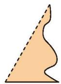
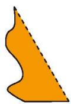
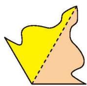
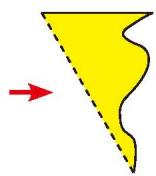
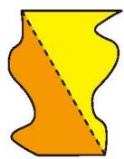
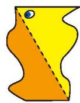

3. 按下面的步骤，可以得到一个别致的图案：

①

②

③

(第3题)
④

⑤
⑥

(1) 准备一张正三角形纸片；

(2) 把纸片任意撕成两部分 (如图①、图②);

(3) 以图①中原正三角形的一边为对称轴, 画出与图①成轴对称的图形 (如图③), 并将新画出的图形以正三角形的这条边的中点为旋转中心旋转, 得到图④ (图②保持不动);

(4) 把图④平移到图②的右边, 得到图⑤;

(5) 对图⑤进行适当的修饰, 便得到一个别致的图案 (如图⑥)。

仿照上述步骤具体做一做。
