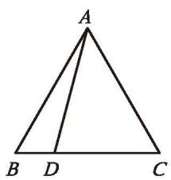
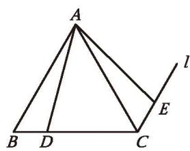

9. 如图（1），点 D 在正三角形 ABC 的边 BC 上，将 $\triangle ABD$ 绕点 A 旋转，使得旋转后点 B 的对应点为点 C。

(1) 在图 (1) 中画出旋转后的图形。

(2) 小明是这样做的: 如图 (2), 过点 $C$ 作 $BA$ 的平行线 $l$ , 在 $l$ 上取点 $E$ , 使 $CE = BD$ , 连接 $AE$ , 则 $\triangle ACE$ 即为旋转后的图形。请说明小明这样做的道理。

(1)

(2)

(第9题)

## 相关知识点

暂无已审核的相关知识点。

> 来源：北师大版初中数学·八年级下册
