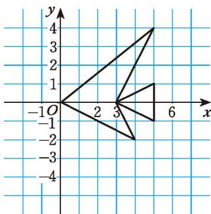

\*13. 如图所示的“鱼”是将坐标为 $(0,0)$ , $(5,4)$ , $(3,0)$ , $(5,1)$ , $(5,-1)$ , $(3,0)$ , $(4,-2)$ , $(0,0)$ 的点用线段依次连接而成的。将这条“鱼”绕原点 $O$ 按顺时针方向旋转 $90^{\circ}$ 。

(1) 画出旋转后的新 “鱼”;

(2) 写出旋转后新 “鱼” 各顶点的坐标。

(第13题)

## 相关知识点

暂无已审核的相关知识点。

> 来源：北师大版初中数学·八年级下册
