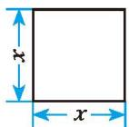
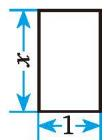
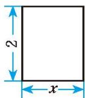
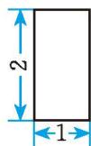

3. 将下列四个图形拼成一个大长方形，再据此写出一个多项式的因式分解。

①

②

(第3题)
③

④

## 相关知识点

- [因式分解的定义（范围关联）](../%E7%9F%A5%E8%AF%86%E7%82%B9/%E5%9B%A0%E5%BC%8F%E5%88%86%E8%A7%A3%E7%9A%84%E5%AE%9A%E4%B9%89.md)

> 来源：北师大版初中数学·八年级下册
