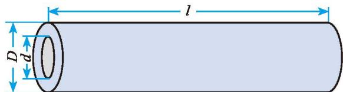

6. 如图, 某农场修建一座小型水库, 需要一种空心混凝土管道, 它的规格是内径 $d = 45 \mathrm{~cm}$ , 外径 $D = 75 \mathrm{~cm}$ , 长 $l = 300 \mathrm{~cm}$ 。利用因式分解计算浇制一节这样的管道大约需要多少立方米的混凝土 ( $\pi$ 取 3.14, 结果精确到 $0.01 \mathrm{~m}^{3}$ )。

(第6题)
