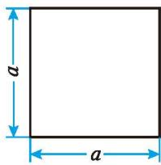
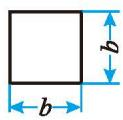
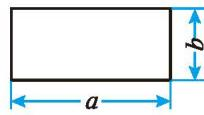

12. 如图, 有①②③三种不同型号的卡片若干, 其中型号①②分别是边长为 $a$ 和 $b$ 的正方形卡片, 型号③是长为 $a\text{、宽为} b$ 的长方形卡片。

①

②

③
(第12题)

(1) 请用这些卡片分别拼出面积为 $2a^{2} + ab, a^{2} + 4ab + 4b^{2}$ 的长方形，并画出图形。

※(2)你能拼出面积为 $3a^{2}+4ab+b^{2}$ 的长方形吗? 如果能, 请画出图形; 如果不能, 请说明理由。

(3)请再提出一个问题,并加以解答。

## 相关知识点

暂无已审核的相关知识点。

> 来源：北师大版初中数学·八年级下册
