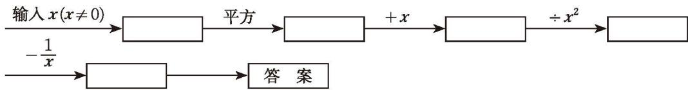

9. 按下列程序计算，把答案填写在表格内，并回答下列问题：

<table><tr><td>输入x</td><td>3</td><td>2</td><td>-2</td><td> $\frac{1}{3}$ </td><td>...</td></tr><tr><td>输出答案</td><td>1</td><td>1</td><td></td><td></td><td>...</td></tr></table>

(1) 由上述计算你发现了什么规律?

(2) 请说明 (1) 中规律的正确性。

## 相关知识点

暂无已审核的相关知识点。

> 来源：北师大版初中数学·八年级下册
