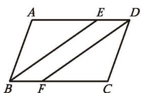

1. 如图, 在 $\square ABCD$ 中, $\angle ABC = 70^{\circ}$ , $\angle ABC$ 的平分线交 $AD$ 于点 $E$ , 过点 $D$ 作 $BE$ 的平行线交 $BC$ 于点 $F$ , 求 $\angle CDF$ 的度数。

(第1题)

## 相关知识点

- [平行线之间的距离的概念与性质（范围关联）](../%E7%9F%A5%E8%AF%86%E7%82%B9/%E5%B9%B3%E8%A1%8C%E7%BA%BF%E4%B9%8B%E9%97%B4%E7%9A%84%E8%B7%9D%E7%A6%BB%E7%9A%84%E6%A6%82%E5%BF%B5%E4%B8%8E%E6%80%A7%E8%B4%A8.md)
- [平行四边形连杆机构原理与应用（范围关联）](../%E7%9F%A5%E8%AF%86%E7%82%B9/%E5%B9%B3%E8%A1%8C%E5%9B%9B%E8%BE%B9%E5%BD%A2%E8%BF%9E%E6%9D%86%E6%9C%BA%E6%9E%84%E5%8E%9F%E7%90%86%E4%B8%8E%E5%BA%94%E7%94%A8.md)

> 来源：北师大版初中数学·八年级下册
