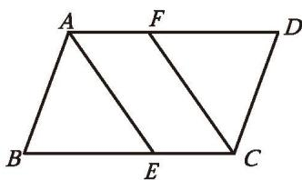

11. 一张平行四边形纸片 $ABCD, AD > AB$ 。

(1)如图,折叠平行四边形纸片 $ABCD$ ,可以得到 $\angle BAD$ 和 $\angle BCD$ 的平分线,其中 $\angle BAD$ 的平分线交 $BC$ 于点 $E$ , $\angle BCD$ 的平分线交 $AD$ 于点 $F$ 。请证明: 四边形 $AECF$ 是平行四边形。

(2) 你还有哪些方法能折出一个平行四边形？选择其中一种，说明你的方法的正确性。

(第11题)
