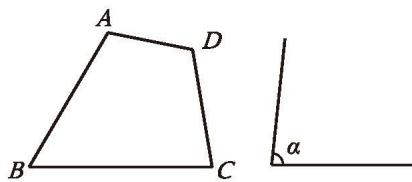

※12.《几何原本》中有这样一道作图题：作一个平行四边形，使它的一个内角等于给定角，面积等于给定多边形的面积。如图，已知四边形ABCD和 $\angle \alpha$ ，如何作 $\square MNGK$ ，使 $\angle N = \angle \alpha$ ，且 $\square MNGK$ 的面积等于四边形ABCD的面积？

(1) 如何确定□MNGK 的一条边长及这条边上的高?

(2) 请用尺规作 □MNGK。

(第12题)
