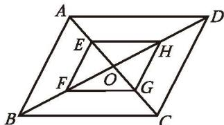

13. 如图, 在 $\square ABCD$ 中, 对角线 $AC$ 与 $BD$ 相交于点 $O$ , 点 $E, F, G, H$ 分别在线段 $AO, BO, CO, DO$ 上。

(1) 如果 $AE = \frac{1}{2} AO$ , $BF = \frac{1}{2} BO$ , $CG = \frac{1}{2} CO$ , $DH = \frac{1}{2} DO$ , 那么四边形 $EFGH$ 是平行四边形吗? 请证明你的结论。

(2) 如果 $AE = \frac{1}{3} AO$ , $BF = \frac{1}{3} BO$ , $CG = \frac{1}{3} CO$ , $DH = \frac{1}{3} DO$ , 那么四边形 $EFGH$ 是平行四边形吗? 请证明你的结论。

(3) 如果 $AE = \frac{1}{n} AO$ , $BF = \frac{1}{n} BO$ , $CG = \frac{1}{n} CO$ , $DH = \frac{1}{n} DO$ , 其中 $n$ 为大于 1 的正整数, 那么上述结论还成立吗?

(第13题)
