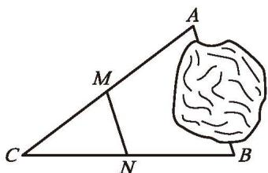

2. 如图, $A$ , $B$ 两地被池塘隔开, 小明通过下面的方法估测出了 $A$ , $B$ 间的距离: 先在 $AB$ 外选一点 $C$ , 然后步测出 $AC$ , $BC$ 的中点 $M$ , $N$ , 并步测出 $MN$ 的长, 由此他就知道了 $A$ , $B$ 间的距离。请解释其中的道理。

(第2题)

## 相关知识点

- [三角形中位线的概念与三角形中位线定理（范围关联）](../%E7%9F%A5%E8%AF%86%E7%82%B9/%E4%B8%89%E8%A7%92%E5%BD%A2%E4%B8%AD%E4%BD%8D%E7%BA%BF%E7%9A%84%E6%A6%82%E5%BF%B5%E4%B8%8E%E4%B8%89%E8%A7%92%E5%BD%A2%E4%B8%AD%E4%BD%8D%E7%BA%BF%E5%AE%9A%E7%90%86.md)

> 来源：北师大版初中数学·八年级下册
